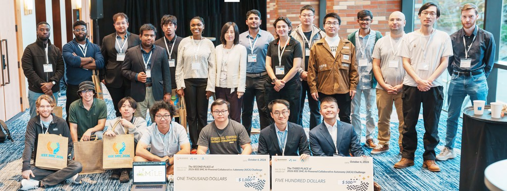
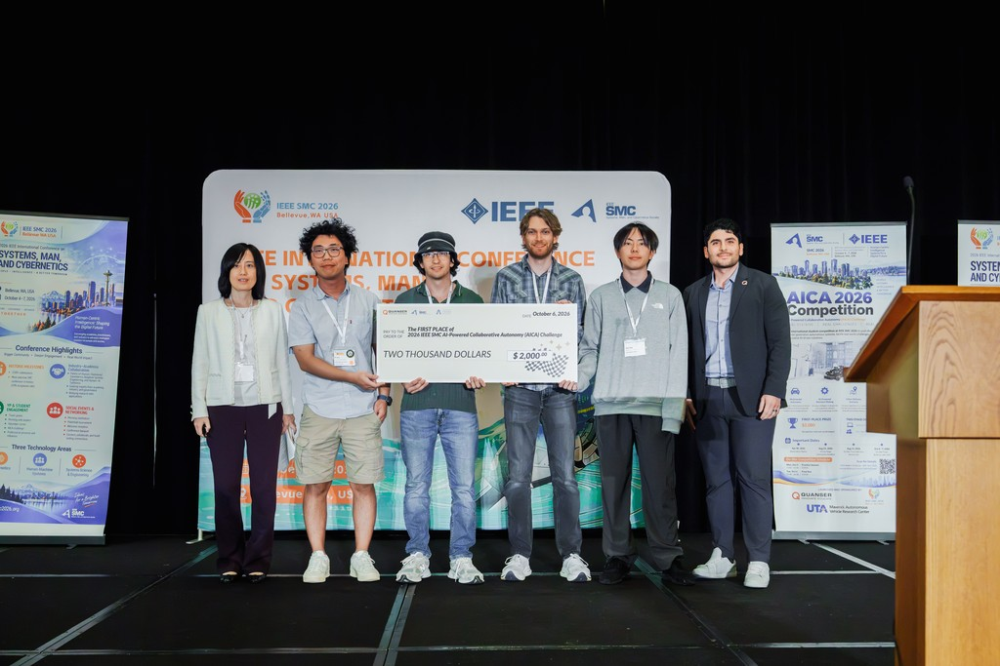
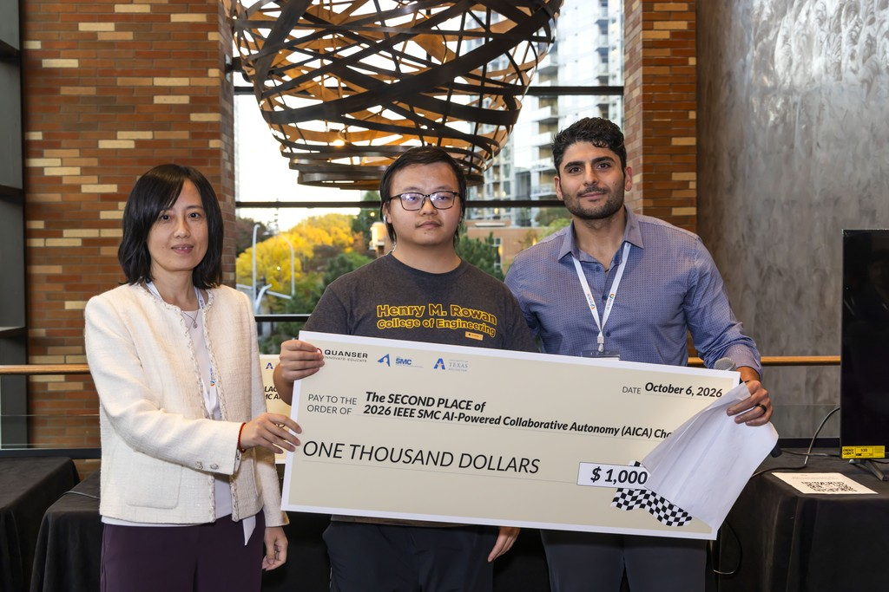
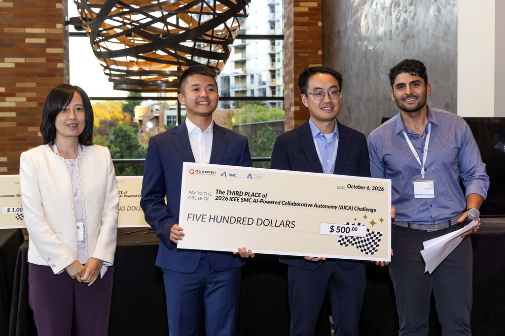

# Results

We are delighted to celebrate the successful completion of the inaugural IEEE SMC
AI-Powered Collaborative Autonomy (AICA) Challenge! The 2026 competition concluded
with the On-Site Finals at IEEE SMC 2026 in Bellevue, Washington, on 7 October 2026.

The AICA Challenge 2026 brought together 23 registered teams with more than 62
team members from 5 countries — the United States, Canada, the
United Kingdom, India, and China. This level of participation exceeded our
expectations for the first year, and we were thrilled to see so many teams from
around the world take on the challenge!

<!-- Each team developed its own multimodal strategies and guidance, navigation, and
control algorithms to coordinate a QCar2 ground vehicle and a QDrone2 aerial
vehicle for package delivery missions in an urban area.  -->
The **Virtual Stage** of the AICA Challenge was held from 30 April 2026 to 21 August 2026. The following ten highest-placed teams earned invitations to the **On-Site Finals**!

| Team | Affiliation |
|------|-------------|
| Aztecs | San Diego State University |
| CSMMC Lab | The Pennsylvania State University |
| SKY Mavericks | The University of Texas at Arlington |
| UA_REU2026 | University of Alabama (REU) |
| For SGA | Tongji University, College of Automotive and Energy |
| Full Throttle | York University |
| ADAMS Lab | University at Buffalo |
| MUSTFly | Macau University of Science and Technology |
| PING | Rowan University |
| Osei | — |

<!-- Nine teams competed live at IEEE SMC 2026 in Bellevue, Washington, on 7 October
2026, bringing their ideas to life in front of a conference audience. With more
deliveries, an urgent delivery window, and a five-minute time limit, the finals
put their strategies to the test. The creativity, teamwork, and variety of
solutions on display made for an exciting finish to our inaugural competition! -->

### Winners

The **On-Site Finals** were held in person at IEEE SMC 2026 in Bellevue, Washington,
from 4 to 7 October 2026, with the final run taking place on 6 October in front of a conference audience. The competition among the top-performing teams was very intense, and we are glad to announce the winners:

- **Aztecs**, San Diego State University — first place, awarded $2,000
- **PING**, Rowan University — second place, awarded $1,000
- **CSMMC Lab**, The Pennsylvania State University — third place, awarded $500

Congratulations to all teams that competed on site. Your
creativity, dedication, and teamwork made this competition a memorable event!

---
## Gallery

  

  

    
    
    
  

---

## Looking Ahead

The next edition of the AICA Challenge will be held at the **IEEE SMC 2027 Conference
in Vietnam**.

---

## Organizers

This competition is organized as part of SMC 2026 and is designed and launched jointly by
[Quanser](https://www.quanser.com/) and
[The University of Texas at Arlington](https://wanlab.uta.edu/)
[Maverick Autonomous Vehicle Research Center (UTA MAVRC)](https://utari.uta.edu/research/maverick-autonomous-vehicle-research-center/).
We sincerely thank the IEEE Systems, Man, and Cybernetics Society, Quanser and SMC 2026 for
sponsoring this event.

For questions, contact [smc.aica.2026@gmail.com](mailto:smc.aica.2026@gmail.com).
